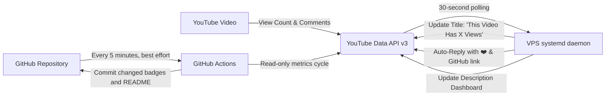

<div align="center">

# YouTube Real-Time Views & Metadata Automation

A lightweight, automated Python service that continuously tracks a YouTube video and dynamically updates its title, description, and GitHub repository metrics in real-time.

[](https://www.youtube.com/watch?v=dINikoQUm6k)

<br/>

[](https://www.youtube.com/watch?v=dINikoQUm6k)
[](https://www.youtube.com/watch?v=dINikoQUm6k)
[](https://www.youtube.com/watch?v=dINikoQUm6k)
[](#deployment)

<br/>

[](https://www.python.org/)
[](https://developers.google.com/youtube/v3)
[](.github/workflows/youtube-updater.yml)
[](LICENSE)

</div>

---

## Live Repository & Video Metrics

The statistics below are synchronized directly with the live YouTube video every cycle. Whenever views, likes, or comments change on YouTube, GitHub Actions commits the updated metrics back to this repository.

<!-- LIVE_METRICS_START -->
| Metric | Real-time Value | Status |
| :--- | :--- | :--- |
| **YouTube Views** | **`31`** | Synchronized |
| **Video Likes** | **`5`** | Active |
| **Total Comments** | **`19`** | Live |
| **Current Title** | **`This Video Has 31 Views`** | Active |
| **Last Synchronized** | `2026-11-06 07:33:59 UTC` | Automated |
<!-- LIVE_METRICS_END -->

> **Target Video:** [https://www.youtube.com/watch?v=dINikoQUm6k](https://www.youtube.com/watch?v=dINikoQUm6k)

---

## System Architecture



---

## Core Capabilities

### 1. Dynamic Video Title
The video title automatically adapts to the exact view count:
```text
This Video Has 13 Views
```
No extraneous text or mentions are added to the title, keeping it clean and accurate.

### 2. Live Description Dashboard
Every update cycle formats a live engagement board inside the YouTube video description:
- Real-time counters: Total Views, Likes, and Comments.
- **Top Liked Comment (Hall of Fame)**: Highlights the most-liked viewer comment.
- **Latest 3 Comments**: Automatically displays recent comments and author handles.
- **Community Progress Goals**: Visual ASCII bars tracking progress toward like and comment targets.
- **Milestone Tracker**: Checklist celebrating 1, 5, 25, 100, 500, and 1,000+ views.
- **Creator Reference**: Permanent link to creator GitHub profile.

### 3. Personalized Auto-Replies
When viewers post a comment, the bot identifies unreplied entries and responds directly:
```text
Hey @username! ❤️ Thanks for commenting on this video!
You are commenter #15 (watched when the video had 13 views).
Check out my GitHub: https://github.com/diwaskhatri07
```
A local cache (`replied_comments.json`) ensures no comment receives duplicate replies.

### 4. Live GitHub Sync
The bot synchronizes the repository's `metrics.json`, SVG status badges (`badges/views.svg`, `badges/likes.svg`, `badges/comments.svg`), and the live README table on every change.

---

## Configuration

All parameters are managed through `config.json` with zero required CLI prompts:

```json
{
    "video_id": "dINikoQUm6k",
    "check_interval": 30,
    "github_url": "https://github.com/diwaskhatri07",
    "auto_reply_enabled": true,
    "show_top_comment": true,
    "show_latest_comments": true,
    "show_progress_bars": true,
    "show_uptime_and_milestones": true,
    "max_comments_in_description": 3
}
```

### Configuration Parameters

| Option | Type | Default | Description |
| :--- | :--- | :--- | :--- |
| `video_id` | `string` | `"dINikoQUm6k"` | Target YouTube video identifier |
| `check_interval` | `integer` | `30` | Polling frequency in seconds (panel / daemon mode) |
| `github_url` | `string` | `"https://github.com/diwaskhatri07"` | Creator profile link inserted in replies and description |
| `auto_reply_enabled` | `boolean` | `true` | Enables personalized responses to viewer comments |
| `show_top_comment` | `boolean` | `true` | Features most-liked comment in description |
| `show_latest_comments` | `boolean` | `true` | Includes recent comments in description |
| `show_progress_bars` | `boolean` | `true` | Displays ASCII goal bars for likes and comments |
| `show_uptime_and_milestones` | `boolean` | `true` | Displays runtime uptime and view milestone checklist |
| `max_comments_in_description` | `integer` | `3` | Maximum number of recent comments to list |

---

## Deployment

### Option A: GitHub Actions (five-minute GitHub metrics)

The workflow (`.github/workflows/youtube-updater.yml`) polls YouTube stats about every five minutes and commits metrics only when values change. Each workflow execution runs one cycle and exits; that is expected. GitHub Actions is not an always-on host and does not provide 30-second scheduling. Scheduled starts can also be delayed.

Code pushes and pull requests run the separate syntax-only CI workflow (`.github/workflows/ci.yml`) without needing YouTube credentials. This validates code but does not deploy it to a VPS.

Add a repository Actions secret named `YOUTUBE_TOKEN_PICKLE_B64` containing the base64-encoded OAuth token file. Never commit `token.pickle` or `client_secret.json`. Rotate/revoke any OAuth credentials that were previously published before relying on the new secret.

### Option B: Server Panels (Pterodactyl / aaPanel / cPanel)

1. Upload the project files to your server panel directory.
2. Set the startup command:
   ```bash
   python main.py
   ```
3. The daemon will start immediately and poll every 30 seconds.

### Option C: Linux VPS (Systemd Service — always-on 30-second checks)

1. Clone the project on the VPS:
   ```bash
   sudo git clone https://github.com/DiwasKhatri07/This-Video-Has-X-Views.git /opt/youtube-views
   ```
2. Copy the OAuth token file from a trusted local machine separately; do not add it to Git:
   ```bash
   scp token.pickle root@<SERVER_IP>:/opt/youtube-views/token.pickle
   ssh root@<SERVER_IP> "chmod 600 /opt/youtube-views/token.pickle"
   ```
3. Set `check_interval` to `30` in `config.json`, then execute the automated installer:
   ```bash
   cd /opt/youtube-views
   chmod +x deploy_vps.sh
   sudo ./deploy_vps.sh
   ```
4. Monitor logs and service state:
   ```bash
   systemctl status youtube-updater
   journalctl -u youtube-updater -f
   ```

The service keeps polling after each cycle and restarts after a crash. It handles YouTube metadata and comment replies. GitHub Actions publishes repository metrics separately every five minutes. After changing the service unit, install it again and reload systemd with `sudo systemctl daemon-reload && sudo systemctl restart youtube-updater`.

Pushing code to GitHub does not by itself update an already-running VPS. Pull the code on the VPS and restart the service, or configure a separate SSH deployment workflow with VPS host/user/key secrets.

### Option D: Local Development

```bash
# Clone the repository
git clone https://github.com/DiwasKhatri07/This-Video-Has-X-Views.git
cd This-Video-Has-X-Views

# Set up virtual environment
python -m venv .venv
source .venv/bin/activate  # On Windows: .\.venv\Scripts\activate

# Install requirements
pip install -r requirements.txt

# Run the automation
python main.py
```

---

## API Quota Management

YouTube Data API v3 provides a complimentary tier of **10,000 quota units per day**:
- `videos.list` (fetching stats): **1 unit**
- `commentThreads.list` (reading comments): **1 unit**
- `videos.update` (updating title/description): **50 units**
- `comments.insert` (auto-replying): **50 units**

The 30-second daemon makes about 5,760 read units per day when it performs one video-stat request and one comment-list request per cycle. The five-minute GitHub metrics workflow adds about 288 stat reads per day. Metadata updates and auto-replies cost 50 units each, so their frequency must remain low enough for the project's daily quota. The daemon now avoids a fixed metadata update every five minutes and reuses the same fetched comments for reply detection. High activity can still exhaust quota; watch Google Cloud's quota dashboard.

---

## Developer

**Diwas Khatri**  
Kathmandu, Nepal  
- GitHub: [@DiwasKhatri07](https://github.com/DiwasKhatri07)
- YouTube: [@DiwasOP](https://www.youtube.com/@DiwasOP)

---

## License

This project is licensed under the [MIT License](LICENSE).
